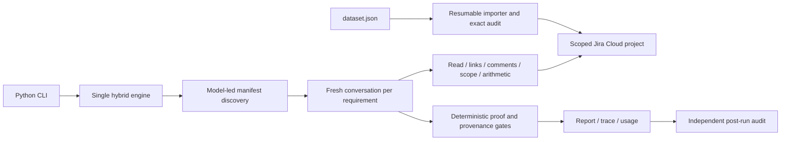

# Design and review notes

## Architecture

## Trust boundaries

Only the importer reads the source dataset in a live workflow. Assessment tools fetch scoped Jira data; model/tool outputs and source text are untrusted until validated. A manifest defines the exercise target and requirements, but cannot grant a new tool or change system policy. Scenario actor/role/event time comes from recorded text, never native Jira authorship/time.

The model has no shell, filesystem, web search, external URL or Jira mutation tool. Secrets remain in the transport. Traces scrub known secret values, and packaging uses an allowlist.

## Gate limitations

Exact quote, source-chain membership, current-session visibility, dimension matching and named authority are code checks. Explicit count/latency/cost/quality results, clear failures, explicit supersession and obvious unresolved same-role QA contradictions are also checked. Regexes operate on the supplied fictional evidence format; they are not a general proof of natural-language correctness. Unknown wording needs manual review or a conservative insufficient-evidence finding. A heuristic injection flag can have false positives and is not a complete security boundary.

An approved target result may supersede an earlier result only when it explicitly names that run, has a later recorded timestamp and matches recorded role/scope. A newer file position is not precedence. Current conflicts between equally authoritative QA reports are not arbitrarily converted into PASS/FAIL; an open confirmed applicable defect still establishes failure.

The model still explains acceptance semantics and rejected evidence. Complete coverage and independent post-run audit complement code gates; neither makes an LLM infallible.

## Operational limitations

- Jira indexing is eventually consistent. After an ambiguous create, wait for indexing and inspect scoped identities before retrying.
- Import audits and assessment reads are not one atomic Jira snapshot. Avoid editing the dedicated project during the run.
- Comment grouping recognizes only known routine prefixes; all other text remains visible. Comment pagination can retrieve every original.
- A requirement is bounded by model turns/time; total requests/tool calls/tokens are bounded too. Checks occur between calls.
- Provider-returned usage can be unavailable for failed requests. Metrics explicitly disclose incomplete accounting.
- Partial investigations are preserved and clearly marked, never packaged as completed assessments.
- Exact scope checks do not infer equivalent commits or production-equivalent environments from unstated context.
- Do not run overlapping importers against the same Jira project.

## Why CLI

The brief accepts any architecture and asks reviewers to assess evidence handling and reproducibility. The CLI puts those behaviors directly behind repeatable commands and has zero third-party runtime dependencies.
